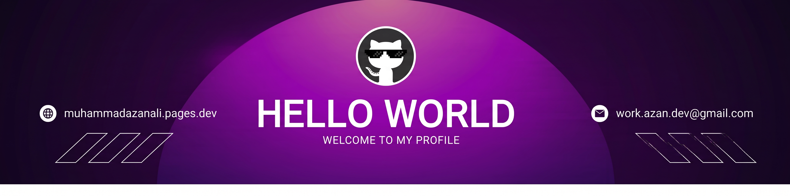
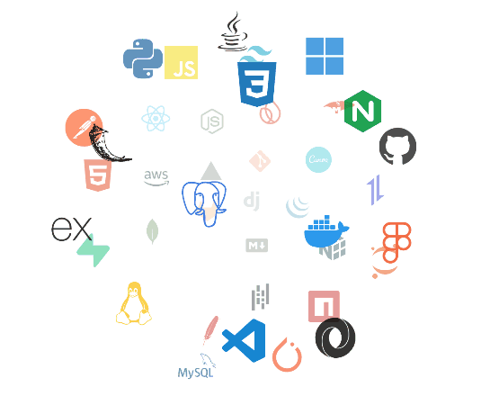
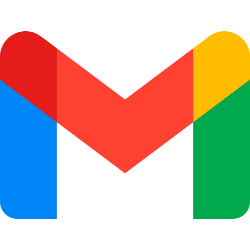
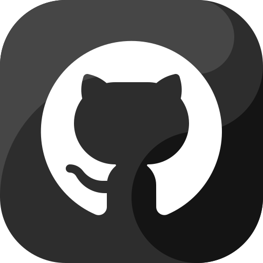

<!-- Banner -->

  

<!-- Night Owl image -->

  

<!-- Header Name -->
#  ɪ'ᴍ ᴀᴢᴀɴ ᴀʟɪ!

*Digital Craftsman (Full-Stack MERN | Next.js | React Native Developer)*

I am a Full-Stack Developer and Architect with a huge love for **Next.js (App Router), React.js, React Native, Node.js, Express, MongoDB, MySQL** and **REST APIs**.

- ✨ Student of life :)
- 🌱 I'm currently learning **Docker**, **DevOps** and **Advanced System Architecture** — every day is a learning opportunity.
- ⚡ Architecting high-concurrency **MERN** & **Next.js** systems with **Redux Toolkit**.
- 📱 Engineering fluid, cross-platform mobile apps using **React Native**.
- 🔐 Building secure **Node.js & Express** APIs with JWT authentication.
- ❤️ Contributing to Open Source.
- 💻 Visit my [Portfolio](https://muhammadazanali.pages.dev) or check out my [Resume](./resume.pdf) for more details about me.

  

 

<!-- Tech Stack & Projects -->
## 
Tᴇᴄʜ sᴛᴀᴄᴋ & Lᴀᴛᴇsᴛ Pʀᴏᴊᴇᴄᴛs

<picture>
  <source media="(prefers-color-scheme: dark)" srcset="./Skills_Animation_Dark.gif" />
  <source media="(prefers-color-scheme: light)" srcset="./Skills_Animation_White.gif" />
  
</picture>

### Current Learning

- Exploring Docker, containerization and modern DevOps pipelines.
- Deepening expertise in scalable microservices and advanced architecture.
- Optimizing server-rendered Next.js (App Router) and Redux Toolkit patterns.

### Latest Projects

- 🎵 [**MusicX**](https://github.com/Azan-Aly) — A Spotify-like music streaming app with playlists, search & a seamless audio player.
- 📝 [**Result Checker**](https://github.com/Azan-Aly) — Student result portal to search & view marks, grades and report cards instantly.
- 🔗 [**Sniply — URL Shortener**](https://github.com/Azan-Aly) — Low-latency redirects with real-time click analytics & auth.
- ⚙️ [**Basecampy Core Engine**](https://github.com/Azan-Aly) — Project management REST API suite with JWT auth.
- 💬 [**MERN Social Platform**](https://github.com/Azan-Aly) — Social feed with media uploads, user graph & comments.
- 📺 [**YouTube Media Client**](https://github.com/Azan-Aly) — Responsive video UI with dynamic routing.

 

<!-- Trophies -->
## 
🏆 Gɪᴛʜᴜʙ Tʀᴏᴘʜɪᴇs 🏆

  

<!-- Github Stats Table -->
<table align="center">
  <tr>
    <td width="50%">
      <h3 align="center">Gɪᴛʜᴜʙ Sᴛᴀᴛs</h3>
      

        
      

    </td>
    <td width="50%">
      <h3 align="center">Sᴛʀᴇᴀᴋ Sᴛᴀᴛs</h3>
      

        
      

    </td>
  </tr>
  <tr>
    <td width="50%">
      <h3 align="center">Lᴀᴛᴇsᴛ Pʀᴏᴊᴇᴄᴛ</h3>
      

        
      

    </td>
    <td width="50%">
      <h3 align="center">Tᴏᴘ Lᴀɴɢᴜᴀɢᴇs</h3>
      

        
      

    </td>
  </tr>
</table>
 

<!-- Contribution Graph -->
## 
📈 Cᴏɴᴛʀɪʙᴜᴛɪᴏɴ Gʀᴀᴘʜ 📈

  

<!-- Thought of the Day (auto-updated daily by .github/workflows/update-quote.yml) -->
## 
🌟 Tʜᴏᴜɢʜᴛ ᴏғ ᴛʜᴇ Dᴀʏ 🌟

<!--STARTS_HERE_QUOTE_CARD-->

    

<!--ENDS_HERE_QUOTE_CARD-->

<!-- Contact -->
## 
🤝 Cᴏɴɴᴇᴄᴛ Wɪᴛʜ Mᴇ 🤝

  
  
  
  
  

  

<!-- Footer -->

  

